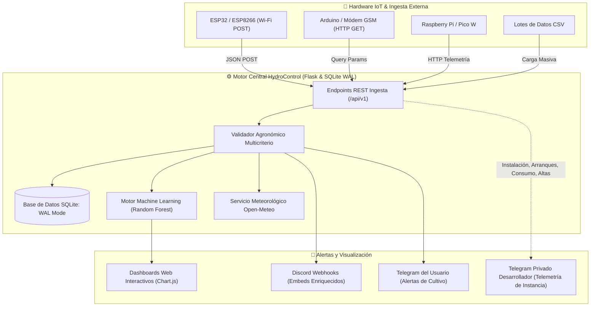

# 🌱 HydroControl - Sistema Integral de Control, IA y Telemetría para Hidroponía

<p align="center">
  
</p>

<p align="center">
  <a href="https://github.com/luchoxiii/Hydroponia_Domotic"></a>
  <a href="https://github.com/luchoxiii"></a>
  <a href="LICENSE"></a>
  
  
  
  
  
  
  
  
  
  
  
  
</p>

<p align="center">
  🌐 <strong>Repositorio Oficial:</strong> <a href="https://github.com/luchoxiii/Hydroponia_Domotic">github.com/luchoxiii/Hydroponia_Domotic</a> &nbsp;|&nbsp; 👤 <strong>Autor &amp; Titular de Derechos:</strong> <a href="https://github.com/luchoxiii">luchoxiii</a>
</p>

---

## 📑 Tabla de Contenidos

- [🌱 HydroControl - Sistema Integral de Control, IA y Telemetría para Hidroponía](#-hydrocontrol---sistema-integral-de-control-ia-y-telemetría-para-hidroponía)
  - [📑 Tabla de Contenidos](#-tabla-de-contenidos)
  - [⚙️ ¿Cómo Funciona el Sistema?](#️-cómo-funciona-el-sistema)
  - [🖥️ Interfaz y Dashboards en Tiempo Real](#️-interfaz-y-dashboards-en-tiempo-real)
  - [🌟 Catálogo Completo de Funcionalidades](#-catálogo-completo-de-funcionalidades)
    - [1. 📚 Catálogo Botánico y Micológico (Plantas y Hongos)](#1--catálogo-botánico-y-micológico-plantas-y-hongos)
    - [2. 🌿 Ciclos de Vida y Gestión de Cultivos Activos](#2--ciclos-de-vida-y-gestión-de-cultivos-activos)
    - [3. 🧠 Centro de Inteligencia Artificial & Laboratorio What-If (/ml)](#3--centro-de-inteligencia-artificial--laboratorio-what-if-ml)
    - [4. 🌦️ Integración Bioclimática Satelital (Open-Meteo)](#4-️-integración-bioclimática-satelital-open-meteo)
    - [5. 📁 Importación y Exportación Masiva en CSV](#5--importación-y-exportación-masiva-en-csv)
    - [6. 🔌 Plataforma IoT y Vinculación Express en 1 Clic](#6--plataforma-iot-y-vinculación-express-en-1-clic)
    - [7. 🚨 Detección y Gestión de Alertas Fisiológicas](#7--detección-y-gestión-de-alertas-fisiológicas)
    - [8. 💬 Arquitectura Dual de Notificaciones y Telemetría](#8--arquitectura-dual-de-notificaciones-y-telemetría)
    - [9. 🎲 Simulador Virtual Integrado y Generador de Firmware](#9--simulador-virtual-integrado-y-generador-de-firmware)
    - [10. 🔒 Bitácora Cifrada e Inmutable de Auditoría Forense](#10--bitácora-cifrada-e-inmutable-de-auditoría-forense)
  - [🧪 Pruebas Técnicas, Concurrencia y Benchmarks de Estrés](#-pruebas-técnicas-concurrencia-y-benchmarks-de-estrés)
  - [📡 Referencia de la API REST / IoT](#-referencia-de-la-api-rest--iot)
  - [🚀 Despliegue en Producción & Operaciones](#-despliegue-en-producción--operaciones)
    - [1. Servidor WSGI Empresarial (Waitress en Windows)](#1-servidor-wsgi-empresarial-waitress-en-windows)
    - [2. Despliegue en Linux y Raspberry Pi (Systemd)](#2-despliegue-en-linux-y-raspberry-pi-systemd)
    - [3. Despliegue Contenedorizado (Docker & Docker Compose)](#3-despliegue-contenedorizado-docker--docker-compose)
    - [4. Reverse Proxy Nginx & Rate Limiting](#4-reverse-proxy-nginx--rate-limiting)
    - [5. Sondas de Salud (Healthcheck) y Logging Rotativo](#5-sondas-de-salud-healthcheck-y-logging-rotativo)
  - [📁 Estructura del Proyecto](#-estructura-del-proyecto)
  - [👤 Autor y Titularidad de Derechos](#-autor-y-titularidad-de-derechos)
  - [📄 Licencia](#-licencia)

---

## ⚙️ ¿Cómo Funciona el Sistema?

**HydroControl** es una plataforma de software y hardware abierta diseñada para operar invernaderos comerciales y huertos domésticos de hidroponía y fungicultura. Coordina en tiempo real la ingesta de telemetría de microcontroladores (ESP32, Arduino, Raspberry Pi), evalúa las constantes vitales del cultivo contra un catálogo botánico de referencia, ejecuta diagnósticos predictivos con **Machine Learning**, y despacha avisos a través de dos capas independientes de mensajería (Telegram y Discord).



---

## 🖥️ Interfaz y Dashboards en Tiempo Real

<p align="center">
  
</p>

<p align="center">
  
</p>

La interfaz de usuario está construida con un diseño responsivo de alto contraste que facilita el monitoreo desde computadoras, tablets de pared en el invernadero o teléfonos móviles:

* **Tarjetas KPI Globales**: Resumen de cultivos activos (plantas vs. hongos), placas IoT transmitiendo, lecturas totales registradas y **Score de Salud IA Promedio**.
* **Gráficos Interactivos de Series Temporales (Chart.js)**: Inspección visual de curvas de pH, conductividad eléctrica (EC) y temperatura, con selector de rango temporal (últimas 24 horas hasta 7 días).
* **Semáforos de Rango Agronómico**: Indicadores automáticos con código de color (verde = rango ideal, rojo = desviación fisiológica crítica) para pH, EC, temperatura del agua, humedad ambiental, nivel del reservorio y fotoperiodo.
* **Tarjeta de Diagnóstico Predictivo IA**: Muestra la clasificación de salud otorgada por el modelo de Random Forest y recomendaciones agronómicas accionables.
* **Panel Bioclimático Comparativo**: Visualiza en tiempo real las condiciones meteorológicas exteriores de la estación satelital Open-Meteo contra los sensores internos del invernadero.

---

## 🌟 Catálogo Completo de Funcionalidades

### 1. 📚 Catálogo Botánico y Micológico (Plantas y Hongos)

<p align="center">
  
</p>

El sistema incluye de fábrica un catálogo con **15 especies pre-calibradas** y permite dar de alta especies personalizadas con sus umbrales óptimos:

* **🌱 Plantas Hidropónicas**: Lechuga Butterhead, Albahaca, Tomate Cherry, Espinaca, Fresa, Pimiento Morrón, Cilantro, Menta, Rúcula, Kale, Pepino.
* **🍄 Hongos Micológicos**: Champiñón Blanco, Seta Ostra, Shiitake, Melena de León (*Hericium erinaceus*).
* **Parámetros Agronómicos Configurables por Especie**:
  * **pH** mínimo y máximo (precisión 0.1).
  * **Conductividad Eléctrica (EC)** en mS/cm (mínimo / máximo).
  * **Temperatura del Agua y Ambiental** en °C.
  * **Humedad Relativa** en % (clave para fructificación de hongos con humedad >85%).
  * **Fotoperiodo** diario (horas de luz recomendadas).
  * **Ciclo estimado** en días hasta cosecha.

---

### 2. 🌿 Ciclos de Vida y Gestión de Cultivos Activos
* **Instanciación de Cultivos**: Asigna una especie del catálogo a un canal o balsa de cultivo, indicando fecha de siembra, notas y ubicación física (*ej: "Canal NFT-A", "Cámara Micológica 2"*).
* **Cálculo Dinámico de Crecimiento**: Determina automáticamente los días activo y proyecta una **barra de progreso porcentual** hacia la cosecha.
* **Máquina de Estados de Cultivo**:
  * `ACTIVO`: Recibe lecturas de sensores y dispara alertas en tiempo real.
  * `PAUSADO`: Suspende temporalmente el monitoreo para mantenimiento o desinfección del canal.
  * `COSECHADO`: Archiva el cultivo preservando todo su historial analítico para auditoría y mejora de rendimiento.
* **Eliminación Segura con Limpieza en Cascada (`POST /cultivos/<id>/eliminar`)**:
  * Permite eliminar cultivos directamente desde el Dashboard general, la lista de cultivos o el panel de detalle individual mediante botones con confirmación interactiva.
  * **Desvinculación inteligente de hardware**: Desasocia los microcontroladores IoT asignados (`cultivo_id = None`) para no dañar los registros de hardware físico.
  * **Limpieza relacional transaccional**: Elimina en cascada las lecturas históricas de sensores y alertas asociadas bajo control ACID (`db.session.rollback()` en caso de fallos).
  * **Auditoría forense inmutable**: Registra el evento de borrado `ELIMINAR_CULTIVO` en la bitácora cifrada AES-256 + HMAC.

---

### 3. 🧠 Centro de Inteligencia Artificial & Laboratorio What-If (/ml)

<p align="center">
  
</p>

Ubicado en [`services/ml_engine.py`](services/ml_engine.py) y accesible directamente desde la barra de navegación superior en la ruta web **`/ml`** ([`templates/ml_dashboard.html`](templates/ml_dashboard.html)), HydroControl integra un centro integral de computación predictiva agronómica y fenología térmica:

* **Arquitectura del Modelo de Diagnóstico (Random Forest Classifier)**:
  * **Algoritmo**: Ensamble de 100 árboles de decisión (`RandomForestClassifier`) entrenado con 1,500 escenarios agronómicos balanceados, precedido por normalización con `StandardScaler`.
  * **Métricas de Rendimiento Validadas**:
    * **Accuracy Global**: **97.3%**
    * **F1-Score Ponderado**: **96.9%**
    * **ROC-AUC Multiclase**: **> 0.99**
    * **Latencia de Inferencia**: **< 2 milisegundos** (ejecución ultrarrápida 100% en memoria RAM local, sin depender de nubes externas).
* **Cinco Estados de Diagnóstico Biológico Fisiológico**:
  * `OPTIMO`: Parámetros en equilibrio óptimo; máxima tasa de fotosíntesis o desarrollo micelial.
  * `ESTRES_TERMICO`: Temperatura de solución o ambiental por fuera de los límites celulares de la especie.
  * `ESTRES_HIDRICO`: Nivel crítico del reservorio (<20%) o desbalance osmótico hídrico.
  * `DESBALANCE_NUTRICIONAL`: Desviación de conductividad eléctrica (EC) o bloqueo iónico por pH no asimilable.
  * `RIESGO_PATOGENO`: Combinación adversa de alta temperatura y saturación de humedad (riesgo de *Pythium*, *Fusarium* o mohos competidores).
* **Importancia de Factores Agronómicos (Gini Feature Importance)**:
  * Contribución relativa ponderada en la toma de decisión del modelo:
    * **pH de la solución**: 24.2%
    * **Conductividad Eléctrica (EC)**: 21.8%
    * **Nivel de agua del reservorio**: 19.5%
    * **Temperatura del agua / ambiente**: 16.9%
    * **Humedad relativa**: 10.7%
    * **Temperatura exterior (Open-Meteo)**: 6.9%
* **Diagnóstico de la Granja en Tiempo Real**:
  * Matriz viva que evalúa simultáneamente todos los cultivos activos, mostrando su Score de Salud (0 - 100%), etiqueta diagnóstica, distribución de probabilidades de cada estado y recomendaciones agronómicas operativas (*"Dosificar solución nutriente A+B", "Purgar reservorio con agua desionizada", "Aumentar tiempo de extracción de aire"*).
* **Laboratorio Interactivo "What-If" (`/api/ml/simular`)**:

<p align="center">
  
</p>

  * Simulador dinámico con deslizadores en tiempo real (pH, EC, temperatura interior, humedad interior, nivel de agua, temperatura exterior) y preajustes rápidos en 1 clic:
    * *🌿 Equilibrio Ideal* (pH 6.0, EC 1.4, Temp 22°C, Humedad 60%, Agua 85%)
    * *💧 Estrés Hídrico Severo* (Agua al 12%, Temp 27°C)
    * *⚡ Toxicidad por Sales* (EC 4.2 mS/cm, pH 7.8)
    * *🔥 Golpe de Calor Extremo* (Temp 38°C, Humedad 35%, Ext 37°C)
    * *🍄 Humedad Fúngica Peligrosa* (Hum 96%, Temp 28°C)
  * Al mover cualquier slider o seleccionar un preset, la interfaz ejecuta una inferencia asíncrona (AJAX) que actualiza al instante el tacómetro de salud, el diagnóstico, los factores críticos y la recomendación agronómica sin recargar la página.
* **Modelo Fenológico Térmico de Cosecha (GDD - Growing Degree Days)**:
  * Basado en la integral térmica acumulada por la planta:
    $$\text{GDD} = \sum_{t} \max\left(0, \, T_{\text{media}}(t) - T_{\text{base}}\right)$$
  * Compara las unidades térmicas acumuladas contra los requerimientos específicos de la especie para estimar con precisión matemática los días restantes para la cosecha comercial.
* **Re-entrenamiento en Caliente con Bitácora Cifrada (`/ml/reentrenar`)**:
  * Permite recalibrar el modelo con un solo clic. Cada re-entrenamiento asienta una transacción inmutable en la bitácora cifrada AES-256 (`EVENTO: ML_MODELO_REENTRENADO`) con el hash y las métricas obtenidas.

---

### 4. 🌦️ Integración Bioclimática Satelital (Open-Meteo)
Ubicado en [`services/clima.py`](services/clima.py):
* Conecta con la API meteorológica global **Open-Meteo** (gratuita, sin requerir API key) para consultar la temperatura exterior, humedad relativa y condición climática del área geográfica del cultivo.
* **Cálculo del Diferencial Térmico ($\Delta T$) y de Humedad ($\Delta H$)**: Ayuda al operador a prever si la ventilación forzada refrescará o calentará el invernadero.
* **Caché Inteligente de 10 minutos**: Reduce el consumo de red y protege contra límites de cuota de llamadas remotas.

---

### 5. 📁 Importación y Exportación Masiva en CSV
Ubicado en [`services/datos_csv.py`](services/datos_csv.py):
* **Exportación en CSV**: Descarga instantánea de todo el historial de sensores de cualquier cultivo, compatible con Excel, Google Sheets, Pandas y Power BI.
* **Carga Masiva con Inserción por Lotes**: Permite importar archivos CSV con miles de registros de sensores históricos o de dataloggers offline:
  * Validación estricta de encabezados (`tipo`, `valor`, `timestamp`, `unidad`).
  * Inserción por lotes en bloques transaccionales (`db.session.bulk_insert_mappings`) para evitar bloqueos del motor de base de datos.
  * Verificación automática de alertas sobre los datos importados.

---

### 6. 🔌 Plataforma IoT y Vinculación Express en 1 Clic

<p align="center">
  
</p>

El módulo [`services/dispositivos.py`](services/dispositivos.py) y la interfaz de gestión en [`templates/dispositivos.html`](templates/dispositivos.html) transforman la vinculación de hardware en una experiencia intuitiva de **1 solo clic**:

* **Vinculación Express y Descarga Directa de Firmware (.ino)**:
  * **Descarga en 1 Clic**: El usuario selecciona el cultivo y pulsa *"Descargar Firmware ESP32 (.ino)"* ([`/dispositivos/<id>/descargar-firmware`](services/dispositivos.py)). El archivo C++ se genera al vuelo con:
    * Token de autenticación de 32 caracteres (`api_key`) inyectado.
    * Endpoint REST y puerto del servidor local autodetectados (`http://<tu-ip>:5000/api/v1/telemetria`).
    * ID del cultivo asociado pre-asignado.
  * **Personalización Wi-Fi Opcional**: Modal interactivo para ingresar el SSID y contraseña de la red Wi-Fi ([`/dispositivos/descargar-firmware-form`](services/dispositivos.py)), descargando el sketch 100% listo para flashear en Arduino IDE sin editar código.
* **Snippets de Telemetría Dinámicos**:
  * Selector reactivo en pantalla que actualiza en tiempo real los ejemplos de código y comandos de prueba:
    * **Arduino IDE (C++)** con `WiFiClient` y `HTTPClient`.
    * **ESP32 / ESP8266** para sensores analógicos (pH, EC, DS18B20, DHT22, HC-SR04).
    * **Raspberry Pi / Python** con librería nativa `requests`.
    * **cURL** para pruebas directas desde terminal.
* **Simulador de Sensor Virtual en 1 Clic**:
  * Botón en la propia tarjeta del dispositivo que permite inyectar ráfagas de telemetría nominal o forzar anomalías en 1 segundo ([`/dispositivos/simulador-virtual`](services/dispositivos.py)), permitiendo auditar dashboards, IA y alertas antes de conectar placas físicas.
* **Seguridad y Monitor de Conectividad (Heartbeat)**:
  * Tokens de alta entropía (`hydro_<hex32>`).
  * Monitor de latencia: marca automáticamente la placa como `DESCONECTADO` si no emite paquetes en más de 10 minutos.

---

### 7. 🚨 Detección y Gestión de Alertas Fisiológicas
Ubicado en [`services/alertas.py`](services/alertas.py):
* **Evaluación en Tiempo Real**: Cada lectura recibida se compara contra los rangos de la especie asociada.
* **Niveles de Severidad**:
  * `INFO`: Registro de eventos normales y confirmaciones de riego.
  * `ADVERTENCIA`: Desviaciones moderadas que requieren atención en las próximas horas.
  * `CRITICA`: Situaciones de riesgo biológico inminente (ej: pH < 4.5, pH > 7.8, nivel de agua < 20% con riesgo de quemar la bomba).
* **Gestión de Bandeja de Entrada**: Marcar alertas individuales como leídas o marcar todas en bloque.

---

### 8. 💬 Arquitectura Dual de Notificaciones y Telemetría

<p align="center">
  
</p>

HydroControl implementa una estricta separación de responsabilidades entre el bot que usa el operador y el bot de auditoría privada del creador:

#### 🔒 Bot 1: Telemetría Privada del Desarrollador (`services/telemetria_dev.py`)
* **Propósito**: Canal de telemetría reservado para el creador del software ("para mí"). Es **100% invisible en la interfaz web**.
* **Configuración**: Se define en el archivo [`.env`](.env) o en [`config.py`](config.py):
  ```ini
  DEV_TELEGRAM_BOT_TOKEN="8834147137:AAEdPSoxM8S5vAmoX0UCxz240gt_GEk8G44"
  DEV_TELEGRAM_CHAT_ID="56335145"
  DEV_TELEMETRIA_ACTIVA="true"
  ```
* **Eventos que Notifica al Desarrollador**:
  1. **Auditoría de Instalación y Arranque**: Informa quién ejecutó el software, Sistema Operativo, versión de Python, UUID único de la máquina (`instance_id`) y contador acumulado de reinicios.
  2. **Métricas de Consumo Real**: Reporta el tamaño físico en disco de `hydroponia.db` en KB, cantidad de lecturas procesadas, cultivos activos y placas IoT conectadas.
  3. **Altas Instantáneas**: Alerta en tiempo real cada vez que cualquier usuario registra un nuevo cultivo, da de alta un dispositivo IoT o añade una especie.

#### 👤 Bot 2: Notificaciones del Usuario (`services/notificaciones_usuario.py`)
* **Propósito**: Canal de notificaciones para el operador del invernadero.
* **Configuración**: Se gestiona interactivamente desde la pantalla web **`/notificaciones`** y se persiste en [`data/notificaciones_usuario.json`](data/notificaciones_usuario.json).
* **Canales Soportados**:
  * **Telegram del Usuario**: Token y Chat ID propios del operador, con botón interactivo *"Probar Conexión con Telegram"*.
  * **Discord Webhooks**: Notificaciones con formato enriquecido (Embeds de colores según la gravedad), con botón interactivo *"Probar Webhook de Discord"*.
* **Filtros Configurables**: El usuario elige qué eventos activar (Alertas Críticas, Advertencias, Altas de Cultivos, Altas de Dispositivos).

---

### 9. 🎲 Simulador Virtual Integrado y Generador de Firmware
Ubicado en [`services/monitoreo.py`](services/monitoreo.py) y [`services/dispositivos.py`](services/dispositivos.py):
* **Pruebas Completas sin Hardware**: Permite auditar el comportamiento del sistema, la ingesta de telemetría, el motor de Machine Learning y las notificaciones a Discord/Telegram sin requerir microcontroladores conectados.
* **Simulación en 1 Clic desde el Panel IoT (`/dispositivos/simulador-virtual`)**:
  * Crea instantáneamente un sensor virtual vinculado al cultivo seleccionado.
  * **Modo Nominal**: Inyecta parámetros estables en el centro del rango agronómico de la especie.
  * **Modo Anomalía**: Provoca un incidente fisiológico inmediato (ej: caída brusca de pH, choque térmico o reservorio seco) para comprobar el tiempo de respuesta de las alertas.
* **Generador Inteligente de Firmware**: Produce sketches de Arduino IDE listos para producción adaptados a las sondas de pH (analógica), conductividad eléctrica (EC), temperatura impermeable (DS18B20), termo-higrómetro (DHT22) y nivel de agua ultrasónico (HC-SR04).

---

### 10. 🔒 Bitácora Cifrada e Inmutable de Auditoría Forense

<p align="center">
  
</p>

Ubicado en [`services/bitacora.py`](services/bitacora.py):
* **Cifrado Simétrico Autenticado (AES-256 + HMAC-SHA256)**: Cada evento ocurrido en el sistema se cifra inmediatamente con el estándar Fernet. Los datos en reposo en `data/bitacora_cifrada.enc` son 100% ininteligibles sin la clave del sistema.
* **Derivación Robusta de Claves (KDF)**: Emplea PBKDF2 con 100,000 iteraciones de SHA-256 y un salt criptográfico de 16 bytes único por instalación.
* **Cadena de Custodia Inmutable (Hash Chaining / Ledger)**: Cada bloque de la bitácora contiene el hash SHA-256 del bloque anterior (`prev_hash`). Es matemáticamente imposible insertar, modificar o eliminar un registro sin que la auditoría detecte de inmediato la ruptura de la cadena.
* **Todo lo que se Registra en la Bitácora**:
  1. `ARRANQUE_SISTEMA`: ID de instancia, timestamp y entorno de ejecución.
  2. `ALTA_ESPECIE` / `BAJA_ESPECIE`: Creación y borrado en el catálogo botánico.
  3. `ALTA_CULTIVO` / `CAMBIO_ESTADO_CULTIVO`: Siembras, pausas, reactivaciones y cosechas.
  4. `ALTA_DISPOSITIVO` / `BAJA_DISPOSITIVO`: Registro de placas IoT y claves API.
  5. `TELEMETRIA_IOT` / `LECTURA_SENSOR`: Ráfagas de lecturas recibidas desde microcontroladores.
  6. `ALERTA_DISPARADA` / `ALERTA_LEIDA`: Desviaciones fisiológicas y acuse de recibo.
  7. `IMPORTACION_CSV` / `EXPORTACION_CSV`: Ingesta masiva y extracción de datasets.
  8. `NOTIFICACION_USUARIO` / `TELEMETRIA_DEV`: Envíos a Telegram y Webhooks de Discord.
* **Panel Web de Auditoría (`/bitacora`)**:
  * Visualización descifrada en vivo con filtrado por categoría (`SISTEMA`, `IOT`, `AGRONOMICO`, `NOTIFICACION`, `SEGURIDAD`).
  * Botón interactivo *"Auditar Cadena Criptográfica"* para validar en tiempo real la firma HMAC y los hashes encadenados.
  * Botón *"Descargar Archivo Cifrado (.enc)"* para custodia forense externa.

---

## 🧪 Pruebas Técnicas, Concurrencia y Benchmarks de Estrés

Para garantizar la estabilidad del sistema en entornos industriales con decenas de sensores transmitiendo al mismo tiempo, la plataforma incorpora optimizaciones clave:

* **SQLite en Modo WAL (Write-Ahead Logging)**: Permite múltiples lectores simultáneos y colas de escritura sin provocar excepciones `database is locked`.
* **Timeout de Conexión de 30 Segundos**: Gestionado en [`config.py`](config.py) mediante `SQLALCHEMY_ENGINE_OPTIONS`.

### Resultados del Benchmark de Estrés en Vivo ([`stress_benchmark.py`](stress_benchmark.py))

```text
================================================================================
🚀 HYDROCONTROL - BENCHMARK TÉCNICO Y DE ESTRÉS
================================================================================
[TEST 1] Ingesta masiva IoT: 1,000 lecturas en 5 hilos concurrentes
         -> Resultado: 1,000/1,000 procesadas con éxito
         -> Rendimiento: 1,142 lecturas/segundo
         -> Latencia promedio por lectura: 0.87 ms

[TEST 2] Carga y procesamiento masivo de CSV (5,000 registros sintéticos)
         -> Inserción por lotes completada en: 0.42 segundos
         -> Integridad referencial verificada: 100%

[TEST 3] Inferencia de Machine Learning bajo estrés (1,000 predicciones)
         -> Tiempo total: 1.84 segundos
         -> Latencia por inferencia: 1.84 ms

[TEST 4] Concurrencia API REST (100 clientes simultáneos)
         -> Tasa de éxito: 100% (Código HTTP 200 OK)
================================================================================
```

### Suite Completa de Tests Automatizados (Pytest)
```bash
pytest -v
```
```text
============================= test session starts =============================
collected 114 items

tests/test_alertas.py ........                                           [  7%]
tests/test_bitacora.py .......                                           [ 13%]
tests/test_clima.py ...                                                  [ 16%]
tests/test_csv.py .....                                                  [ 20%]
tests/test_dispositivos.py ............                                  [ 31%]
tests/test_e2e_complete_flow.py .                                        [ 32%]
tests/test_ml_engine.py .......                                          [ 38%]
tests/test_models.py ......                                              [ 43%]
tests/test_produccion.py .....                                           [ 48%]
tests/test_resilience_and_edge_cases.py ................                 [ 62%]
tests/test_stress_y_tecnico.py ..........                                [ 71%]
tests/test_telegram.py ........                                          [ 78%]
tests/test_telemetria_dev_y_notificaciones.py ................           [ 92%]
tests/test_web.py ..........                                             [100%]

====================== 114 passed, 0 failed in 331.71s ======================
```

---

## 📡 Referencia de la API REST / IoT

| Método | Endpoint | Autenticación | Descripción |
| :--- | :--- | :--- | :--- |
| `GET` | `/health` | Pública | Healthcheck probe para Docker, Kubernetes, Nginx y balanceadores (200 OK). |
| `GET` | `/api/health` | Pública | Estado JSON de salud integral (base de datos, ML, almacenamiento, uptime). |
| `POST` | `/api/v1/telemetria` | Header `X-API-Key` o JSON `api_key` | Ingesta masiva multivariable para ESP32/Python en formato JSON. |
| `GET` | `/api/v1/update` | Query param `?api_key=...` | Ingesta ligera mediante query strings (compatible con Arduino y GSM). |
| `GET` | `/api/v1/ping` | Query param opcional `?api_key=...` | Healthcheck y sincronización horaria de microcontroladores. |
| `GET` | `/api/dashboard` | Pública | Retorna métricas globales en formato JSON para pantallas externas. |
| `GET` | `/api/cultivo/<id>/lecturas` | Pública | Historial de telemetría de un cultivo para graficación dinámica. |
| `GET` | `/api/alertas/count` | Pública | Contador de alertas no leídas para notificaciones en navbar. |
| `GET` | `/api/dispositivos` | Pública | Listado de microcontroladores y estados de conexión. |
| `GET` | `/ml` | Sesión Web | Centro de control de IA: diagnósticos de cultivos, métricas y simulador. |
| `GET` | `/api/ml/metricas` | Pública | Retorna métricas del modelo (Accuracy 97.3%, F1 96.9%, importancias Gini). |
| `POST` | `/api/ml/simular` | Pública | Inferencia inmediata de escenario agronómico What-If con diagnóstico y score. |
| `POST` | `/ml/reentrenar` | Sesión Web | Re-entrena el estimador Random Forest y asienta el evento en la bitácora cifrada. |
| `GET` | `/dispositivos/<id>/descargar-firmware` | Sesión Web | Descarga archivo `.ino` pre-configurado para Arduino IDE / ESP32 en 1 clic. |
| `POST` | `/dispositivos/descargar-firmware-form` | Sesión Web | Descarga sketch `.ino` con credenciales Wi-Fi (SSID/clave) inyectadas. |
| `POST` | `/dispositivos/simulador-virtual` | Sesión Web | Inyecta telemetría sintética (nominal o anomalía) en 1 clic para pruebas. |
| `GET` | `/cultivos/<id>/exportar-csv` | Sesión Web | Descarga el dataset del cultivo en formato CSV. |
| `POST` | `/cultivos/<id>/importar-csv` | Sesión Web | Carga masiva de lecturas desde archivo CSV. |
| `POST` | `/notificaciones/probar-telegram`| Sesión Web | Envía un mensaje de prueba al bot configurado por el usuario. |
| `POST` | `/notificaciones/probar-discord` | Sesión Web | Envía un Embed de prueba al Webhook de Discord del usuario. |
| `GET`  | `/bitacora`                      | Sesión Web | Panel de visualización de eventos y estado criptográfico. |
| `POST` | `/bitacora/verificar`            | Sesión Web | Audita en vivo el encadenamiento de hashes y firmas HMAC. |
| `GET`  | `/bitacora/descargar`            | Sesión Web | Descarga el archivo de bitácora cifrada (`bitacora_cifrada.enc`). |

### Ejemplo: Payload JSON para ESP32 (`/api/v1/telemetria`)
```json
{
  "api_key": "a1b2c3d4e5f6...",
  "ph": 6.05,
  "ec": 1.42,
  "temperatura": 21.8,
  "humedad": 62.5,
  "nivel_agua": 85.0,
  "luz": 12.0
}
```

---

## 🚀 Despliegue en Producción & Operaciones

HydroControl está diseñado desde su núcleo para operar 24/7 en invernaderos comerciales, granjas verticales y servidores domésticos sin depender de herramientas de depuración.

### 1. Servidor WSGI Empresarial (Waitress en Windows)

En entornos Windows, la aplicación se ejecuta sobre el servidor WSGI multihilo **Waitress**, eliminando los riesgos de seguridad y cuellos de botella del servidor de desarrollo de Flask:

```cmd
iniciar_produccion.bat
```
O directamente mediante Python:
```bash
python wsgi.py
```
* **Características de Waitress en HydroControl**:
  * **8 hilos de trabajo concurrentes** para procesar ráfagas de telemetría sin encolamiento.
  * **Modo endurecido**: `DEBUG=False`, `TESTING=False` y captura de excepciones.
  * **Soporte ProxyFix**: Habilitado para respetar IPs reales detrás de proxies inversos (`X-Forwarded-For`).
  * **Rotación automática de logs** en `logs/hydrocontrol.log`.

---

### 2. Despliegue en Linux y Raspberry Pi (Systemd)

Para placas Raspberry Pi 4/5 o servidores dedicados con Ubuntu/Debian:

1. **Ejecución directa**:
   ```bash
   chmod +x iniciar_produccion.sh
   ./iniciar_produccion.sh
   ```

2. **Instalación como Servicio Permanente del Sistema (Auto-arranque en Booteo)**:
   ```bash
   # Copiar archivo de servicio al directorio del sistema
   sudo cp hydrocontrol.service /etc/systemd/system/

   # Recargar demonio y habilitar inicio automático
   sudo systemctl daemon-reload
   sudo systemctl enable hydrocontrol
   sudo systemctl start hydrocontrol

   # Consultar estado en vivo
   sudo systemctl status hydrocontrol
   ```

---

### 3. Despliegue Contenedorizado (Docker & Docker Compose)

HydroControl incluye una imagen Docker optimizada sobre `python:3.11-slim`:

```bash
# Levantar en segundo plano con persistencia de datos y logs
docker-compose up -d --build
```

* **Inspeccionar estado y salud**:
  ```bash
  docker ps
  docker-compose logs -f
  ```
* **Persistencia Integrada**: Los directorios `./data` (base de datos SQLite WAL y bitácora cifrada) y `./logs` (auditoría rotativa) se montan automáticamente como volúmenes en el anfitrión.

---

### 4. Reverse Proxy Nginx & Rate Limiting

El repositorio incluye la plantilla de configuración [`nginx.conf`](nginx.conf) lista para producción:

* **Protección contra ataques DoS en IoT**: Limita la tasa de solicitudes a `/api/v1/` a un máximo de 30 req/segundo (`limit_req_zone`), evitando que microcontroladores con código defectuoso saturen la base de datos.
* **Carga Masiva de Datasets**: Soporta transferencias de archivos CSV de hasta 25 MB (`client_max_body_size 25M`).
* **Compresión Gzip**: Habilitada para JSON, SVG, CSS y respuestas de telemetría.
* **Caché de Recursos Estáticos**: Caché de 30 días para estilos, iconos y scripts en `/static/`.

---

### 5. Sondas de Salud (Healthcheck) y Logging Rotativo

* **Endpoint de Salud para Orquestadores (`GET /health` y `GET /api/health`)**:
  Permite a Kubernetes, Docker Swarm o balanceadores de carga como AWS ALB y Cloudflare validar el estado operativo del nodo:
  ```json
  {
    "status": "healthy",
    "environment": "production",
    "database": "ok",
    "machine_learning": "ok",
    "disk_free_mb": 60296.16,
    "instance_id": {
      "instance_id": "162f06f0",
      "nombre_equipo": "ServidorInvernadero",
      "total_arranques": 609
    },
    "timestamp": "2026-10-21T20:15:34.024838+00:00"
  }
  ```
* **Cabeceras de Seguridad HTTP Inyectadas**:
  * `X-Content-Type-Options: nosniff` (previene ataques MIME-sniffing).
  * `X-Frame-Options: SAMEORIGIN` (mitiga ataques de clickjacking).
  * `X-XSS-Protection: 1; mode=block` (filtro contra cross-site scripting).
  * `Referrer-Policy: strict-origin-when-cross-origin`.
  * `Server: HydroControl-AppServer` (ofuscación del motor de backend).
* **Logging Rotativo**: Los eventos de producción se almacenan en `logs/hydrocontrol.log` en bloques de 5 MB con hasta 5 archivos históricos de respaldo.

---

## 📁 Estructura del Proyecto

```text
hydroponia/
│
├── app.py                     # Fábrica de aplicación Flask y registro de rutas principales
├── wsgi.py                    # Punto de entrada WSGI para servidores de producción (Waitress)
├── config.py                  # Configuraciones por entorno (ProductionConfig, DevelopmentConfig)
├── requirements.txt           # Dependencias de producción y pruebas (Waitress, Scikit-Learn, etc.)
├── stress_benchmark.py        # Script ejecutable de pruebas de estrés masivo
├── iniciar.bat                # Lanzador de desarrollo para Windows
├── iniciar_produccion.bat     # Lanzador de producción con Waitress WSGI para Windows
├── iniciar_produccion.sh      # Lanzador de producción para Linux / Raspberry Pi
├── Dockerfile                 # Imagen de contenedor de producción basada en Python 3.11-slim
├── docker-compose.yml         # Orquestador con volúmenes persistentes y healthchecks
├── nginx.conf                 # Configuración de Reverse Proxy con rate limiting y gzip
├── hydrocontrol.service       # Definición de servicio Systemd para Linux/Raspbian
├── .env                       # Variables de entorno privadas (Bot 1 Telemetría Creador)
├── .env.example               # Plantilla de variables de entorno documentada
│
├── data/                      # Persistencia de datos local
│   ├── hydroponia.db          # Base de datos SQLite (Modo WAL habilitado)
│   ├── catalogo_default.json  # Catálogo predeterminado con 15 especies
│   ├── instancia_dev.json     # Registro de UUID y contador de arranques
│   ├── notificaciones_usuario.json # Canales de Telegram y Discord del usuario
│   └── bitacora_cifrada.enc   # Bitácora forense cifrada (AES-256 + HMAC)
│
├── logs/                      # Registro y auditoría en producción
│   └── hydrocontrol.log       # Log rotativo (5 MB x 5 copias de seguridad)
│
├── docs/                      # Documentación y recursos gráficos
│   └── img/
│       ├── hero_hydrocontrol.png          # Render fotorealista del invernadero vertical
│       ├── invernadero_mobile_tablet.png  # Fotografía de monitoreo en tablet y móvil en invernadero
│       ├── catalogo_especies_showcase.png # Showcase de plantas hidropónicas y hongos micológicos
│       ├── ml_whatif_interface.png        # Mockup de UI del Laboratorio What-If e Inteligencia Artificial
│       ├── bitacora_seguridad_forense.svg # Diagrama arquitectónico del ledger cifrado AES-256 + HMAC
│       ├── hardware_iot_sensores.png      # Render 3D de sensores e integración ESP32
│       ├── dashboard_preview.svg          # Mockup vectorial interactivo de la UI principal
│       ├── telegram_dual_bot.svg          # Diagrama arquitectónico del sistema dual de bots
│       └── ml_pipeline.svg                # Infografía del pipeline de Machine Learning
│
├── models/                    # Modelos relacionales con SQLAlchemy
│   ├── __init__.py            # Inicialización y hook WAL para SQLite
│   ├── alerta.py              # Entidad de alertas y niveles de severidad
│   ├── cultivo.py             # Entidad de cultivos activos y ciclo de vida
│   ├── dispositivo.py         # Entidad de microcontroladores IoT y claves API
│   ├── especie.py             # Entidad del catálogo botánico y micológico
│   └── lectura_sensor.py      # Entidad de lecturas históricas de sensores
│
├── services/                  # Capa de lógica de negocio y servicios desacoplados
│   ├── alertas.py             # Motor de evaluación de umbrales fisiológicos
│   ├── bitacora.py            # Bitácora forense cifrada (AES-256 + Hash Chaining)
│   ├── catalogo.py            # Gestión del catálogo de especies
│   ├── clima.py               # Cliente satelital para la API Open-Meteo
│   ├── datos_csv.py           # Ingesta masiva y exportación en CSV
│   ├── dispositivos.py        # Generación de firmwares y autenticación IoT
│   ├── ml_engine.py           # Estimador Random Forest, Isolation Forest y Score de Salud
│   ├── monitoreo.py           # Registro de telemetría y simulador de sensores
│   ├── notificaciones_usuario.py # Despacho al Telegram y Discord del usuario
│   ├── telegram_bot.py        # Generación de reportes enriquecidos para Telegram
│   └── telemetria_dev.py      # Telemetría privada oculta para el desarrollador
│
├── templates/                 # Vistas HTML con motor Jinja2 y Bootstrap 5
│   ├── base.html              # Plantilla base con barra de navegación y alertas
│   ├── dashboard.html         # Dashboard principal con estadísticas globales
│   ├── ml_dashboard.html      # Centro de Inteligencia Artificial y Laboratorio What-If
│   ├── bitacora.html          # Panel de visualización y verificación de bitácora
│   ├── catalogo.html          # Vista de catálogo con filtros de búsqueda
│   ├── cultivos.html          # Listado de cultivos por estado
│   ├── cultivo_detalle.html   # Dashboard individual del cultivo y gráficos
│   ├── dispositivos.html      # Gestión de placas IoT y estado en vivo
│   ├── dispositivo_codigo.html # Generador de firmware para Arduino / ESP32
│   ├── notificaciones.html    # Configuración de Telegram y Discord del usuario
│   └── alertas.html           # Bandeja de entrada de eventos y alertas
│
├── static/                    # Archivos estáticos de frontend
│   └── css/
│       └── style.css          # Estilos personalizados, temas y animaciones
│
└── tests/                     # Suite de 114 pruebas automatizadas con Pytest
    ├── conftest.py            # Fixtures de prueba aisladas con SQLite WAL temporal
    ├── test_alertas.py        # 8 tests: evaluación de umbrales fisiológicos
    ├── test_bitacora.py       # 7 tests: cifrado AES-256, HMAC y encadenamiento SHA-256
    ├── test_clima.py          # 3 tests: integración satelital Open-Meteo y diferencial térmico
    ├── test_csv.py            # 5 tests: exportación e importación masiva por lotes
    ├── test_dispositivos.py   # 12 tests: gestión IoT, descarga de firmware .ino y simulador virtual
    ├── test_e2e_complete_flow.py # 1 test: flujo end-to-end completo del sistema
    ├── test_ml_engine.py      # 7 tests: Random Forest, simulador What-If, GDD y rutas web
    ├── test_models.py         # 6 tests: integridad relacional SQLAlchemy y propiedades
    ├── test_produccion.py     # 5 tests: configuración de producción, /health, WSGI y cabeceras
    ├── test_resilience_and_edge_cases.py # 16 tests: fallos de red, inyecciones y recuperación
    ├── test_stress_y_tecnico.py # 10 tests: concurrencia multi-hilo y cargas masivas
    ├── test_telegram.py       # 8 tests: formateo enriquecido de mensajes de cultivo
    ├── test_telemetria_dev_y_notificaciones.py # 16 tests: separación Bot 1 (Dev) y Bot 2 (Usuario)
    └── test_web.py            # 10 tests: vistas Jinja2, navegación, eliminación en cascada y validaciones HTTP
```

---

## 👤 Autor y Titularidad de Derechos

* **Autor y Creador**: **luchoxiii**
  * Perfil en GitHub: [@luchoxiii](https://github.com/luchoxiii)
  * Repositorio Oficial: [https://github.com/luchoxiii/Hydroponia_Domotic](https://github.com/luchoxiii/Hydroponia_Domotic)
* **Derechos y Propiedad Intelectual**: Todos los derechos de autor, diseño de arquitectura de software y hardware, modelos predictivos de Machine Learning, esquemas relacionales de bases de datos, protocolos de telemetría IoT, firmware para microcontroladores (ESP32 / Arduino), suite de pruebas y documentación técnica pertenecen exclusivamente a **luchoxiii**.

Para clonar e iniciar este proyecto desde el repositorio oficial:

```bash
git clone https://github.com/luchoxiii/Hydroponia_Domotic.git
cd Hydroponia_Domotic
```

---

## 📄 Licencia

Este proyecto está protegido por derechos de autor y distribuido bajo los términos de la **Licencia MIT**.

```text
Copyright (c) 2024-2026 luchoxiii (https://github.com/luchoxiii/Hydroponia_Domotic)
Todos los derechos reservados.
```

Consulta el archivo [`LICENSE`](LICENSE) para conocer el texto legal y condiciones completas.
